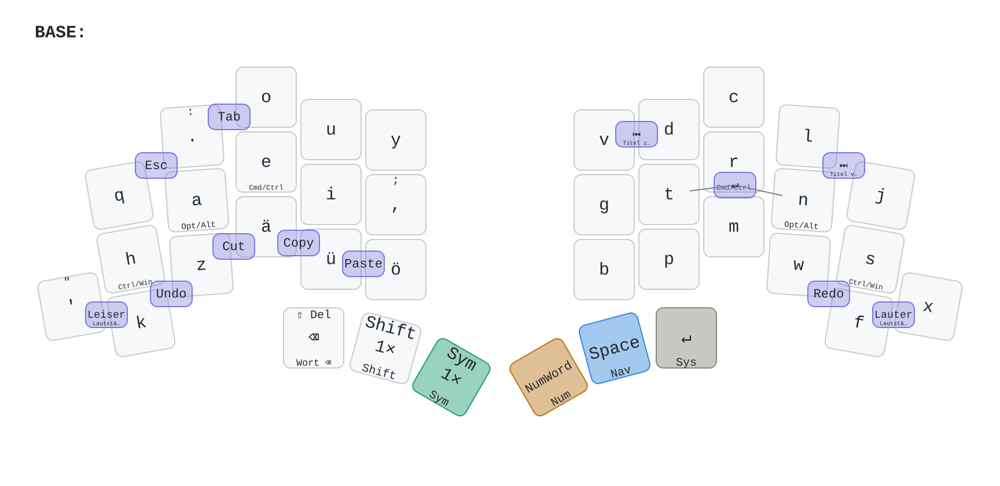
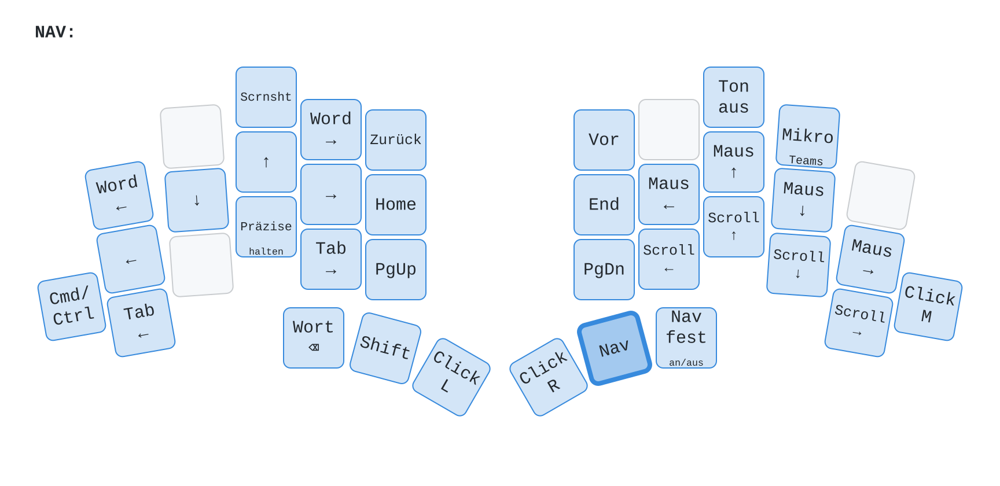
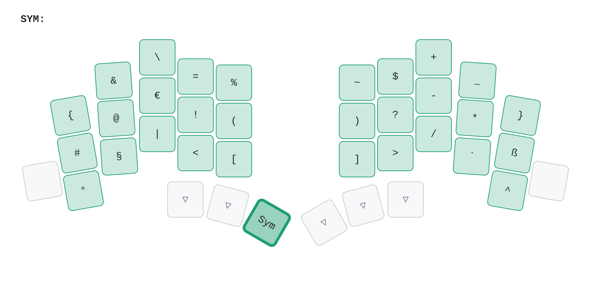
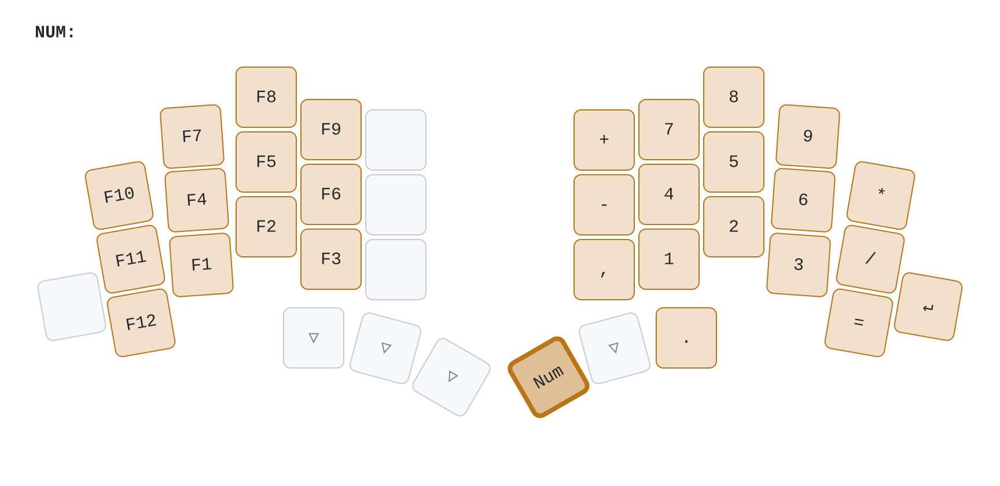
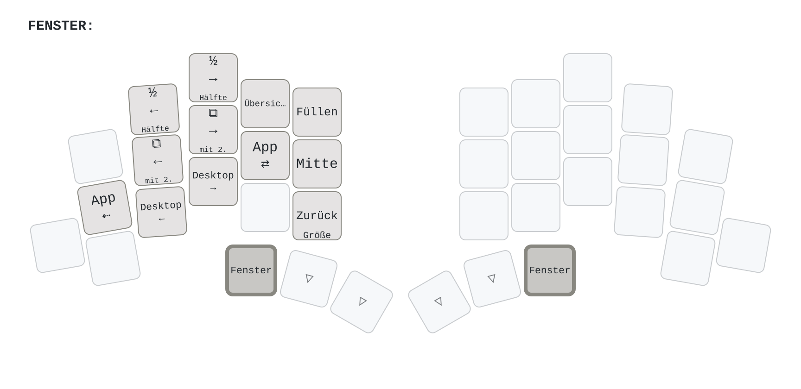
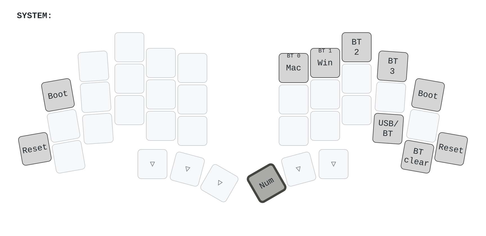

<picture>
  <source media="(prefers-color-scheme: dark)" srcset="/docs/images/TOTEM_logo_dark.svg">
  <source media="(prefers-color-scheme: light)" srcset="/docs/images/TOTEM_logo_bright.svg">
  
</picture>

# ZMK CONFIG FOR THE TOTEM SPLIT KEYBOARD

[Here](https://github.com/GEIGEIGEIST/totem) you can find the hardware files and build guide.\
[Here](https://github.com/GEIGEIGEIST/qmk-config-totem) you can find the QMK config for the TOTEM.

TOTEM is a 38 key column-staggered split keyboard running [ZMK](https://zmk.dev/) or [QMK](https://docs.qmk.fm/). It's meant to be used with a SEEED XIAO BLE or RP2040.

## Diese Konfiguration (Kurzfassung)

- Firmware: ZMK **v0.3** (fest eingestellt in `config/west.yml` und `.github/workflows/build.yml`), Modul urob/zmk-auto-layer v0.3 für Num-Word.
- Belegung: `config/totem.keymap` (anymak:END-Variante, Home-Row-Mods, Combos, Ebenen BASE/NAV/SYM/NUM/SYS). Umlaute ä ü ö nebeneinander links unten, Punkt links oben (Ringfinger), ' und " links außen unten.
- **Daumen:** links Backspace | Shift | Sym, rechts Num | Leertaste/Nav | Enter (antippen) / Fenster (halten). Enter zusätzlich als Kombo t + r + n, auf Num eigene Taste. Backspace: antippen = ⌫ (mit Shift: Entf), halten (ca. 0,2 s) = Fenster-Ebene, antippen und dann halten = ⌫ wiederholt. **System:** Space und Num zusammen halten.
- **Kombos (auf der Basis; Esc und Tab auch auf Num):** Enter = t + r + n, Esc = q + ., Tab = . + o, Zwischenablage auf der unteren Reihe links. Medien: v + d Titel zurück, l + j Titel vor, ' + k leiser, f + x lauter.
- **Nav:** Pfeile links auf der Grundreihe (← ↓ ↑ →), Wort ←/→, Home/End, PgUp/PgDn, Tab ←/→, Zurück/Vor, Screenshot, Ton aus, Teams-Mikro, Wort löschen (linker Daumen außen). Maus rechts (Zeiger auf der Grundreihe, Scrollen darunter), schnell mit sanftem Start; **Präzise** (Position 23 halten) = Maus auf ⅓ Tempo. Shift auf dem linken Daumen wie auf der Basis (33), Klicks mit den Daumen (34 links, 35 rechts), Klick Mitte rechts außen (31). **Nav fest:** Space halten, Position 37 tippen; nochmal 37 = aus.
- **Num:** Ziffernblock rechts wie an einer normalen Tastatur (0 auf dem rechten Daumen, Punkt eingezogen), F-Tasten im gleichen Muster links. Linke Daumen wie auf der Basis, also Shift + . = : **Fenster:** links Hälfte ←/→, Übersicht, Füllen, zwei Fenster nebeneinander, Mitte, App-Wechsel, Desktop ←/→, vorherige Größe. **System:** nur Mac/Win, Bluetooth, USB/BT, Boot/Reset je Hälfte.
- **Zwei Rechner, eine Belegung:** macOS ist Standard (Bluetooth-Profil 0), Windows ist ein Overlay (Profil 1). Jede Funktion liegt auf beiden Systemen auf derselben Taste.
  - Umschalten: Space und Num zusammen halten (System-Ebene), dann **Mac** (rechte Hand, obere Reihe, innen) oder **Win** (daneben).
  - Nach dem Ausschalten startet die Tastatur im Mac-Modus.
- Tastencodes: `keys_de_mac.h` (macOS-Eingabequelle "Deutsch") und `keys_de_win.h` (Windows "Deutsch"). Namen nachschlagen: [docs/keycodes.md](docs/keycodes.md).
- **Fenster-Tasten am Mac:** einmalig in den Systemeinstellungen → Tastatur → Tastaturkurzbefehle → Sondertasten die TOTEM wählen und „Feststelltaste“ auf „Globus“ stellen. Die Fenster-Tasten senden Caps Lock + Ctrl + Taste in einem Rutsch, macOS macht daraus Fn + Ctrl. Ohne diese Einstellung schalten sie die Großschreibung um. Hälfte ←/→ und „zwei Fenster nebeneinander“ brauchen stattdessen eigene App-Kürzel (Fenster → Bewegen und Größe ändern → Links / Rechts / Links & Rechts / Rechts & Links = Ctrl+Opt+Cmd+← / → und dasselbe mit Shift), weil macOS Fn+Pfeil von fremden Tastaturen ignoriert.
- **Tiefschlaf:** nach 10 Minuten ohne Tastendruck schlafen beide Hälften; jede Hälfte wacht durch einen Tastendruck auf sich selbst auf (dieser Tastendruck wird nicht getippt). Nach einer Pause also links und rechts je eine Taste antippen.
- `settings_reset`-Firmware: bei Bluetooth-Problemen auf beide Hälften flashen, danach wieder die normale Firmware.

## Belegung

Die Bilder werden bei jedem Hochladen automatisch neu gezeichnet (`keymap-drawer/draw.py`). Beschriftung von Modifiern: Mac/Windows, z. B. `Cmd/Ctrl`. Farben: Nav blau, Sym grün, Num gelb, Sys grau, Combos lila; ein dicker Rand zeigt die Taste, die die Ebene öffnet.

### Base

### Nav (Leertaste halten, oder fest mit Position 37)

### Sym

### Num

### Fenster (⌫ halten oder rechte äußere Daumentaste halten)

### System (Space und Num zusammen halten)

## Planer (Tasten per Drag & Drop umplanen)

`planner/totem-planer.html` herunterladen (auf GitHub: Datei öffnen → Download) und im Browser öffnen. Es zeigt die aktuelle Belegung auf der echten TOTEM-Geometrie, dazu einen Reiter mit allen Kombos (nach Gruppen) und die Ideenliste. Fährst du über eine Taste, steht dort, was sie tut.

- Tasten ziehen oder nacheinander antippen: Sie werden getauscht, auch zwischen Ebenen. Für Neues einen Wunsch eintragen.
- **"Änderungen kopieren"** und den Text Claude schicken, der die Keymap samt Windows-Zwillingen anpasst.
- Der Entwurf liegt nur in diesem Browser. Er wird zurückgesetzt, sobald sich die Keymap ändert. Vorher kopieren.
- Der Planer wird bei jedem Hochladen automatisch neu erzeugt (`tools/make_planner.py`, Vorlage `planner/template.html`).

## Belegung ändern

- Nur `config/totem.keymap` bearbeiten (auf github.com: Datei öffnen, Stift-Symbol, "Commit changes"). Oben in der Datei steht eine kurze Anleitung ("HOW TO EDIT").
- Jede Mac-Ebene hat eine Windows-Kopie direkt darunter (`..._win_layer`). Wer eine Taste ändert, ändert sie an derselben Stelle in der Kopie.
- Der Build prüft das zuerst (`tools/check_keymap.py`): passt eine Mac-Taste nicht zu ihrer Windows-Kopie, bricht er mit einer verständlichen Meldung ab (GitHub → Actions → "check").
- Tastennamen nachschlagen: [docs/keycodes.md](docs/keycodes.md) (z. B. § = `DE_SECT` / `DEW_SECT`).
- Die Bilder oben zeichnen sich nach jedem Hochladen selbst neu. Danach reicht es, die **linke** Hälfte zu flashen.

## HOW TO USE

- fork this repo
- `git clone` your repo, to create a local copy on your PC (you can use the [command line](https://www.atlassian.com/git/tutorials) or [github desktop](https://desktop.github.com/))
- adjust the totem.keymap file (find all the keycodes on [the zmk docs pages](https://zmk.dev/docs/codes/))
- `git push` your repo to your fork
- on the GitHub page of your fork navigate to "Actions"
- scroll down and unzip the `firmware.zip` archive that contains the latest firmware
- connect the left half of the TOTEM to your PC, press reset twice
- the keyboard should now appear as a mass storage device
- drag'n'drop the `totem_left-seeeduino_xiao_ble-zmk.uf2` file from the archive onto the storage device
- repeat this process with the right half and the `totem_right-seeeduino_xiao_ble-zmk.uf2` file.